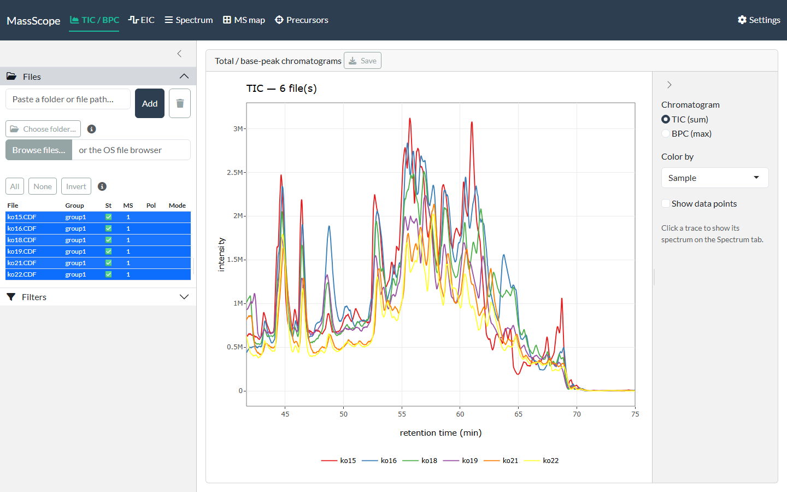

# MassScope 

A local Shiny desktop app for interactively visualising **raw LC-MS data** on the
RforMassSpectrometry stack (`Spectra` / `MsExperiment` / `xcms`) — TIC/BPC,
extracted-ion chromatograms, spectra with adduct / isotope / fragment annotation,
2D/3D maps, and DDA precursors. Plots are ggplot2 rendered through plotly (click,
zoom, hover); static export is via ggsave. Scope is **raw visualisation only** — no
peak picking, grouping or alignment.



## Install

Installing the package pulls in every dependency automatically — including the
Bioconductor packages (Spectra, xcms, mzR, …) and the GitHub-only
[commonMZ](https://github.com/stanstrup/commonMZ). Point at the Bioconductor
repositories first (via BiocManager) so those resolve:

```r
install.packages(c("remotes", "BiocManager"))
options(repos = BiocManager::repositories())
remotes::install_github("stanstrup/MassScope")
```

## Run

```r
MassScope::run_app()
```

A browser tab opens with the plot views across the top (TIC/BPC, EIC, Spectrum, MS
map, Precursors), a **Settings** page, and a left sidebar with **Files** and
**Filters**. Paste a folder of `.mzML` / `.mzXML` / `.CDF` files into the Files box
to begin.

## Documentation

Full guides live on the [package website](https://stanstrup.github.io/MassScope/):

- [**Getting started**](https://stanstrup.github.io/MassScope/articles/getting_started.html)
  — loading files, filtering, settings, export, and moving between tabs
- [TIC / BPC](https://stanstrup.github.io/MassScope/articles/tic_bpc.html)
- [EIC](https://stanstrup.github.io/MassScope/articles/eic.html)
- [Spectrum](https://stanstrup.github.io/MassScope/articles/spectrum.html)
  — single spectra, the scan-list browser, and annotation
- [MS map](https://stanstrup.github.io/MassScope/articles/ms_map.html)
- [Precursors](https://stanstrup.github.io/MassScope/articles/precursors.html)
- [Developer guide](https://stanstrup.github.io/MassScope/articles/developer.html)
  — status, running from a clone, tests, and the project layout

## Deploy with Docker

A `Dockerfile` (`rocker/r-ver` with prebuilt Linux binaries from Posit Package
Manager for both CRAN and Bioconductor, so it builds in minutes) runs the app as a
server:

```sh
docker build -t massscope .
docker run --rm -p 3838:3838 -v /path/to/ms-data:/data massscope
```

Open <http://localhost:3838> and paste `/data` (your mounted files) into the Files
box. Mount a volume at `/root/.config/R` to persist settings across restarts.

## License

MIT © Jan Stanstrup. See [LICENSE.md](LICENSE.md).
