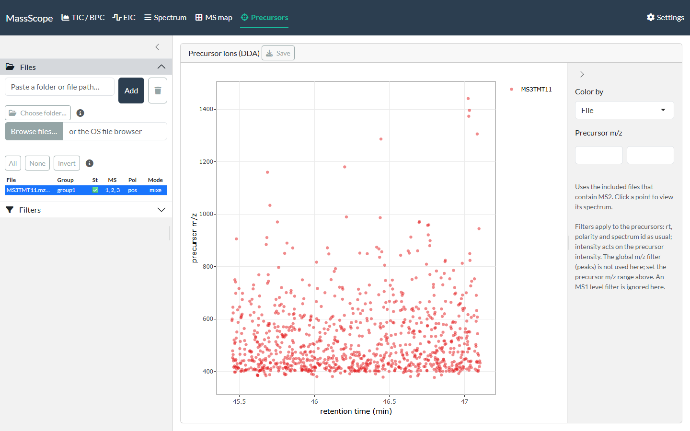

```{r, include = FALSE}
knitr::opts_chunk$set(echo = FALSE, eval = FALSE)
```

For **data-dependent acquisition (DDA)**, the Precursors tab maps each fragmented
precursor ion as a point at its retention time × precursor *m/z*, across the
included MS2 files. It is the quickest way to see *what* was selected for
fragmentation and *when*.

{width=100%}

- **Color by** — *File*, *Sample group*, or none.
- Only files that contain MS2 spectra contribute; if none do, the view says so.

## Filters

The global **Filters** apply here too, read as filters on the *precursors*:

- **Retention time**, **polarity** and **spectrum id** rules select which MS2
  scans are shown, as everywhere else.
- **Intensity** acts on the precursor intensity. A precursor whose intensity
  the file does not report is kept.
- The global **m/z** filter is *not* used here: it selects peaks (on an MS2
  spectrum, fragment *m/z*), which is a different thing from the precursor
  *m/z*. Narrow the y axis with the tab's own **Precursor m/z** range in the
  side panel instead; leave a box empty for an open end.
- The **MS level** filter is ignored unless it names an MSn level (2, 3, ...):
  the default MS1 setting would otherwise leave the map empty.

## Moving between tabs

**Click a precursor point** to send its file, retention time, precursor *m/z* and
scan number to the [Spectrum](spectrum.html) tab. Switch there and that exact
fragmentation scan is loaded, at its own MS level (MS2, or MS3 on MS3 data), even
when the global MS level filter is set to MS1. A click on a chromatogram, by
contrast, picks the nearest scan at the global MS level. From the fragment spectrum
you can click peaks straight into the [EIC](eic.html) list.

## Export

**Save** writes a static image of the precursor map.
